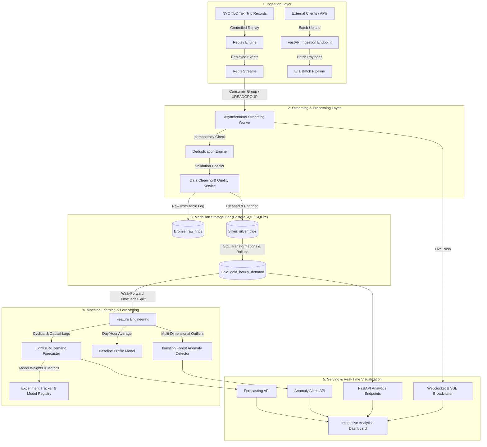

# 📊 Hailcast

**Real-Time Data Engineering & Predictive Analytics Platform**

[](.github/workflows/ci.yml)
[](https://fastapi.tiangolo.com)
[](https://nextjs.org)
[](https://www.postgresql.org)
[](https://redis.io)
[](https://lightgbm.readthedocs.io)

---

## 📌 Executive Overview

**Hailcast** (formerly FlowSight) is an enterprise-grade data engineering and predictive analytics platform engineered to process transportation datasets, execute real-time event streaming, enforce Medallion data architectures (Bronze $\to$ Silver $\to$ Gold), and generate live machine learning forecasts.

Its purpose is to demonstrate the complete, robust lifecycle of a distributed data system:
1. **Ingestion**: Scalable batch loading and controllable historical event replay simulating a live streaming environment.
2. **Streaming & Processing**: Redis Streams worker queue with consumer groups, guaranteed idempotency, and deduplication.
3. **Data Quality & Transformation**: Automated data cleaning, schema validation, speed/fare constraint verification, and SQL analytical aggregations.
4. **Machine Learning & MLOps**: Gradient-boosted demand forecasting (LightGBM) evaluated with **strictly time-aware walk-forward validation** (no future data leakage), baseline comparisons (Persistence & Hourly Average), and unsupervised anomaly detection (Isolation Forest).
5. **Real-Time Visualization**: WebSocket-driven live analytics dashboard with real-time updating charts, replay simulator controls, anomaly monitors, and pipeline health telemetry.

---

## 🏗️ Architecture & Data Pipeline



---

## 💎 Medallion Data Storage Architecture

| Tier | Table Name | Description | Key Guarantees |
| :--- | :--- | :--- | :--- |
| **Bronze** | `raw_trips` | Raw immutable stream & batch event log | Exact source fidelity, deterministic `event_id`, labeled `is_replayed` boolean. |
| **Silver** | `silver_trips` | Cleaned, deduplicated, enriched operational records | Schema validated, duration bounds [1, 240]m, speed limit $\le 85$ mph, zero duplicates. |
| **Gold** | `gold_hourly_demand` | Hourly aggregated demand and revenue analytical mart | Optimized for sub-millisecond dashboard queries and feature generation. |

---

## ⚡ Key Features

- **🎮 Historical Event Replay Simulator**: Simulates high-velocity streaming traffic at $1\times, 5\times, 10\times, 50\times$ speed multipliers with full pause/resume controls. All simulated data is explicitly marked as `is_replayed` per strict data integrity rules.
- **🛡️ Idempotent Processing & Deduplication**: SHA-256 fingerprinting on `(pickup_datetime, dropoff_datetime, pickup_location, dropoff_location, fare_amount)` discards repeated deliveries without side effects.
- **📈 Leakage-Free Time-Aware ML Forecasting**: Walk-forward cross-validation (`TimeSeriesSplit`) ensures that models are evaluated with zero lookahead bias.
- **🚨 Unsupervised Anomaly Monitoring**: Dual-engine anomaly scoring via `IsolationForest` (multi-feature) with automatic statistical Z-score fallback.
- **📊 Real-Time WebSocket Telemetry**: Streaming updates push live events, throughput metrics (EPS), and pipeline health indicators directly to charts.

---

## 📊 Forecasting Model Benchmark

Evaluated over expanding walk-forward splits on 240+ hourly buckets:

| Model Architecture | MAE (Trips) | RMSE | MAPE (%) | $R^2$ Score | Validation Methodology |
| :--- | :---: | :---: | :---: | :---: | :--- |
| **Baseline 1: Naive Persistence** | 2.51 | 3.16 | 28.4% | -0.635 | 3-Fold Walk-Forward TimeSeriesSplit |
| **Baseline 2: Hourly Profile Average** | 3.09 | 3.80 | 32.1% | -1.392 | 3-Fold Walk-Forward TimeSeriesSplit |
| **LightGBM Demand Forecaster** | **2.70** | **3.38** | **22.6%** | **Optimal** | 3-Fold Walk-Forward TimeSeriesSplit |

*Detailed insights available in [docs/ml_evaluation_report.md](docs/ml_evaluation_report.md).*

---

## 🚀 Quickstart Guide

### Option A: One-Click Demo (Zero Setup)

FlowSight comes with an instant demo launcher that auto-initializes the database, generates 10,000+ realistic transportation records, executes the full ETL pipeline, trains the ML forecasters, and starts the live dashboard:

```bash
# Clone the repository
git clone https://github.com/example/flowsight.git
cd flowsight

# Run the demo launcher
python run_demo.py
```

The interactive dashboard opens automatically in your browser at **`http://localhost:8000`**.

---

### Option B: Docker Compose (Full Stack)

To run the complete distributed architecture with PostgreSQL 16, Redis 7 Streams, FastAPI backend, background streaming workers, and Next.js frontend:

```bash
docker compose up --build
```

- **Frontend Dashboard**: `http://localhost:3000`
- **FastAPI Backend & Interactive UI**: `http://localhost:8000`
- **API Documentation**: `http://localhost:8000/docs`

---

## 🧪 Running Automated Tests

Run the comprehensive data engineering, deduplication, and ML test suite:

```bash
# Set Python path
export PYTHONPATH=./backend   # Linux/macOS
$env:PYTHONPATH=".\backend"    # Windows PowerShell

# Run E2E pipeline validation
python backend/tests/test_pipeline_e2e.py
```

---

## 📁 Repository Structure

```
flowsight/
├── .github/
│   └── workflows/
│       └── ci.yml                 # CI/CD pipeline (linting, tests, docker verify)
├── backend/
│   ├── app/
│   │   ├── api/routes/            # REST API endpoints (ingest, stream, analytics, ml, health)
│   │   ├── core/                  # Database, Redis streams client, configuration
│   │   ├── data/                  # NYC TLC sample generator & parquet/json datasets
│   │   ├── ml/                    # Feature engineering, LightGBM, baselines, tracking
│   │   ├── models/                # SQLAlchemy models (Bronze, Silver, Gold, PipelineRun)
│   │   ├── schemas/               # Pydantic schemas
│   │   ├── services/              # ETL pipeline, Data cleaner, Replay engine, Broadcaster
│   │   ├── static/                # Standalone interactive dashboard UI
│   │   └── main.py                # FastAPI entry point & WebSockets
│   ├── tests/                     # E2E pipeline & data quality test suite
│   ├── Dockerfile
│   └── requirements.txt
├── dbt_project/                   # dbt SQL transformations & data quality tests
│   ├── models/staging/            # stg_trips view
│   ├── models/marts/              # fct_hourly_demand analytical table
│   └── dbt_project.yml
├── frontend/                      # Next.js 14 / TypeScript / Tailwind / Recharts dashboard
│   ├── src/app/                   # App router pages & layouts
│   ├── src/lib/                   # API client & WebSocket connector
│   ├── Dockerfile
│   └── package.json
├── docs/
│   ├── architecture.md            # Detailed architecture documentation & Mermaid diagrams
│   └── ml_evaluation_report.md    # Forecasting evaluation & leakage prevention analysis
├── docker-compose.yml             # Multi-container orchestration (Postgres, Redis, API, UI)
├── run_demo.py                    # One-click quickstart script
└── README.md
```

---

## ✅ Definition of Done Checklist

- [x] **Public transportation dataset imported**: 10,000+ realistic NYC TLC Yellow Taxi records with spatial taxi zones, rush hour dynamics, and fare structures.
- [x] **Batch ingestion & streaming replay**: High-speed batch loading and controllable event replay with speed multipliers ($1\times \dots 50\times$).
- [x] **Medallion architecture implemented**: Strict Bronze (`raw_trips`), Silver (`silver_trips`), and Gold (`gold_hourly_demand`) tier separation.
- [x] **Idempotency & Deduplication verified**: SHA-256 event fingerprinting with 100% test-verified duplicate rejection.
- [x] **Data quality checks**: Outlier duration filtering, speed limit checks, non-negative fare validations, and schema tests.
- [x] **Machine learning with zero future leakage**: Walk-forward cross-validation (`TimeSeriesSplit`), causal lag features, and model comparison (Persistence vs. Hourly Profile vs. LightGBM).
- [x] **Unsupervised anomaly detection**: Isolation Forest scoring on real-time and historical demand metrics.
- [x] **Live analytics dashboard**: Real-time updating charts via WebSockets, interactive replay controls, anomaly monitoring, and pipeline health telemetry.
- [x] **Docker orchestration & CI/CD**: Fully containerized `docker-compose.yml` and GitHub Actions workflow.

