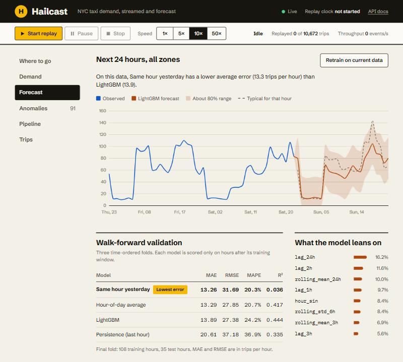
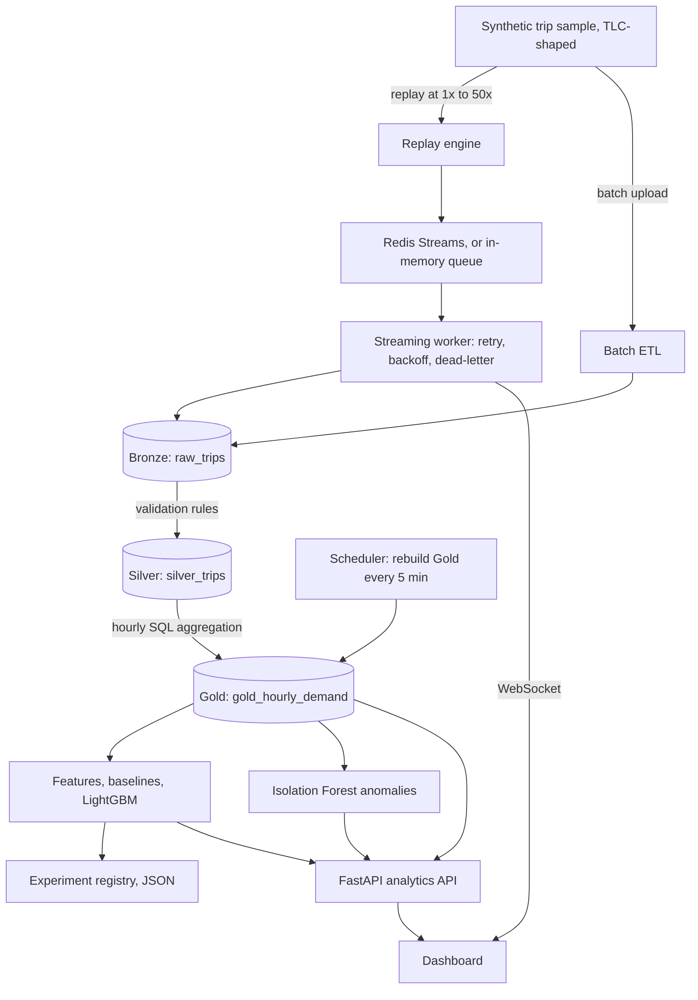

# Hailcast

**Real-time data engineering and predictive analytics for taxi demand.**

**Live demo: <https://hailcast.onrender.com>** (free hosting: if it has been idle, the first load can take up to a minute)

Hailcast ingests trip records in batch and as a replayed event stream, cleans them through
Bronze, Silver and Gold tables, forecasts hourly demand, flags unusual hours, and shows all of it
on a live dashboard. It is a portfolio project that demonstrates data engineering, backend,
machine learning and deployment-readiness in one runnable system.

> **About the data.** The trips are **synthetic**: `backend/app/data/download_sample.py` generates
> about 10,700 records shaped like NYC TLC yellow-taxi trips, with a fixed random seed. The "live"
> stream is those historical records **replayed**; every row carries `is_replayed = true` and the
> dashboard says so. Nothing here is real or current traffic.



## What you can do with it

| View | What it answers |
| :--- | :--- |
| **Where to go** | For a dispatcher: which zones will be busiest in the next 1 to 12 hours, and what a trip there is worth. |
| **Demand** | Trips per hour, filterable by pickup zone and date range, with flagged hours marked. |
| **Forecast** | The next hours of city-wide demand with a range band, and how the model compares to simple baselines. |
| **Anomalies** | Zone-hours whose demand is unusual (Isolation Forest, z-score fallback). |
| **Pipeline** | Row counts per tier, validation checks, batch runs, stream failures, retries and scheduled jobs. |
| **Trips** | Cleaned trip records, filterable by zone, payment type and date. |

## Quick start

Requires Python 3.11 or newer. No database or Redis needed: it falls back to SQLite and an
in-memory queue.

```bash
python -m venv .venv
```

```bash
.venv/Scripts/pip install -r backend/requirements.txt
```

```bash
python run_demo.py
```

(On Linux or macOS the pip path is `.venv/bin/pip`.) The dashboard opens at
<http://localhost:8000>; the API docs are at <http://localhost:8000/docs>.

Then, to walk the whole system:

1. Press **Start replay** and pick a speed. Charts, counts and the trip feed update live over a WebSocket.
2. Open **Pipeline** to watch rows move through Bronze, Silver and Gold and see the validation checks.
3. Open **Forecast** to see the prediction and the measured error of each model.
4. Reproduce the evaluation yourself (next section).

## Reproduce the evaluation

```bash
python -m pytest
```

```bash
python backend/scripts/generate_reports.py
```

The first runs the pipeline, deduplication, failure-handling, filter and leakage tests against a
throwaway database. The second profiles the sample with Polars, loads it through the real pipeline,
runs the walk-forward evaluation and rewrites both reports from what it measured:

- [docs/eda_report.md](docs/eda_report.md): exploratory data analysis.
- [docs/ml_evaluation_report.md](docs/ml_evaluation_report.md): model comparison, per-fold results, leakage checks, limits.

Result of the latest generated run (one hour ahead, city-wide, mean of three walk-forward folds):

| Model | MAE (trips/hour) | RMSE | MAPE | R² |
| :--- | ---: | ---: | ---: | ---: |
| Baseline: same as the previous hour | 20.11 | 37.16 | 37.8% | 0.290 |
| Baseline: average for that hour of day | 31.97 | 42.92 | 121.8% | -0.007 |
| **LightGBM** | 13.30 | 27.88 | 24.6% | 0.512 |

Seven days of synthetic data means each test window is 41 hours. Read these numbers as proof that
the method runs end to end, not as a claim about real demand. In one of the three folds the
previous-hour baseline beats LightGBM, and the report shows it.

## How it works



- **Idempotency.** Every event gets a SHA-256 `event_id` from pickup time, drop-off time, both zones
  and fare. Replaying an event is a no-op, so retries never double-count.
- **Validation.** Silver rejects rows with a drop-off before pickup, a duration outside 1 to 240
  minutes, a distance outside 0 to 150 miles, a fare outside $2.50 to $600, a speed above 85 mph, or a
  passenger count outside 1 to 9. Rejected rows stay in Bronze and are counted in the Pipeline view.
- **Failure handling.** A failing stream batch is retried up to three times with exponential backoff.
  If it still fails it is split into single events; an event that fails alone goes to a dead-letter
  list shown in the Pipeline view. Events are acknowledged on the stream only after that.
- **Scheduled job.** Every five minutes Gold is recomputed from Silver to correct any drift from
  incremental updates. It can also be run from the Pipeline view.
- **No future leakage.** Walk-forward `TimeSeriesSplit`, lag and rolling features shifted by at least
  one hour, and a test that changes future demand and asserts no earlier feature moves.
- **Monitoring.** `GET /api/v1/health/` reports tier counts, queue state, throughput, retries, failed
  events, job results, recent runs and validation checks; the server logs every retry and failure.

More detail: [docs/architecture.md](docs/architecture.md).

## Status against the project brief

Honest state of each item. "Partial" means some of it exists but it is not what the brief names.

| Area | Item | Status |
| :--- | :--- | :--- |
| Frontend | Analytics dashboard | Done. Single-page dashboard served by FastAPI (HTML, CSS, Chart.js). |
| Frontend | Live-updating charts | Done, over WebSocket. |
| Frontend | Filters by date and category | Done: pickup zone, payment type, date range. |
| Frontend | Anomaly and forecast views | Done. |
| Frontend | Next.js + TypeScript | **Partial.** `frontend/` holds an earlier Next.js prototype; it is not the served UI and its Docker image does not build. |
| Backend | Analytics API, batch ingestion | Done (FastAPI). |
| Backend | WebSocket or SSE updates | Done, both. |
| Backend | Authentication | Done where required: an API key locks the upload endpoints on the hosted demo. No user accounts. |
| Data | Public dataset imported | **Not done.** The sample is generated, not downloaded from NYC TLC. |
| Data | Batch ingestion, simulated streaming, replay | Done; replayed data is labelled. |
| Data | Bronze, Silver, Gold | Done. |
| Data | Validation and quality checks | Done. |
| Data | Idempotency and deduplication | Done and tested. |
| Data | SQL transformations | Done in SQLAlchemy. **Partial** for dbt: models exist in `dbt_project/` but are not wired to a profile or run. |
| ML | Exploratory analysis | Done, generated with Polars. |
| ML | Features, baseline, forecasting model | Done. |
| ML | Anomaly detection | Done. |
| ML | Time-aware validation | Done and tested. |
| ML | Experiment tracking | **Partial.** Runs are appended to a JSON registry; MLflow is not installed or used. |
| Infra | Queue or stream processing | Done: Redis Streams with an in-memory fallback. |
| Infra | Retry and failure handling | Done and tested. |
| Infra | Scheduled jobs | Done (in-process scheduler). |
| Infra | Monitoring dashboards and logs | Done at demo level: health endpoint, Pipeline view, logs. No Prometheus or Grafana. |
| Infra | Docker and CI | Done. GitHub Actions runs lint and pytest, then builds the backend image, starts it and checks it serves. `docker compose up` with PostgreSQL and Redis is not covered by CI. |
| Infra | Deployment, public demo URL | Done: <https://hailcast.onrender.com> on Render's free plan, deployed from `render.yaml`. |

## Put it online

[](https://render.com/deploy?repo=https://github.com/YahyaLendani/hailcast)

The repository includes `render.yaml`, a blueprint for one free [Render](https://render.com) web
service that runs the API and the dashboard from `backend/Dockerfile`.

1. Press the button above (or in Render choose **New, Blueprint** and pick the repository) and apply.
2. Render builds the image and gives the app a public `https://<name>.onrender.com` address.
3. In GitHub, set the repository variable `DEMO_URL` to that address (Settings, Secrets and
   variables, Actions, Variables). The `Keep demo awake` workflow then pings it every 10 minutes so
   visitors do not wait for the free plan to wake up.

Things to know:

- **Uploads are locked on the hosted demo.** The blueprint generates an `API_KEY`; the `/ingest`
  endpoints then need it in an `X-API-Key` header. Visitors can still run the replay, filter, retrain
  and run the scheduled job, which only ever touch the built-in sample. Locally, with no `API_KEY`
  set, everything is open.
- **Data is reseeded on every start**, so nothing a visitor does persists across restarts.
- **The image is tested in CI.** Every push builds `backend/Dockerfile`, starts the container and
  checks the dashboard, the API and the upload lock.
- GitHub's scheduler is best effort, and pauses after 60 days without repository activity, so an
  occasional slow first load is still possible.

## Docker

```bash
docker compose up --build
```

Starts PostgreSQL 16, Redis 7 and the API with the dashboard on <http://localhost:8000>. The
standalone stream worker and the Next.js prototype are behind profiles (`--profile worker`,
`--profile next`) because the API already runs a worker and the prototype image does not build yet.

## Repository layout

```
backend/app/api/routes/   REST endpoints: ingest, stream, analytics, ml, health
backend/app/core/         settings, database, Redis Streams client, API-key check
backend/app/data/         sample generator and generated sample
backend/app/ml/           features, baselines, LightGBM, training, experiment registry
backend/app/services/     ETL, validation, replay engine, streaming worker, scheduler, anomalies
backend/app/static/       the dashboard
backend/scripts/          report generator
backend/tests/            pytest suite
dbt_project/              dbt models (not wired yet)
frontend/                 earlier Next.js prototype (not the served UI)
docs/                     architecture, EDA report, ML evaluation report
```

## License

[MIT](LICENSE)
