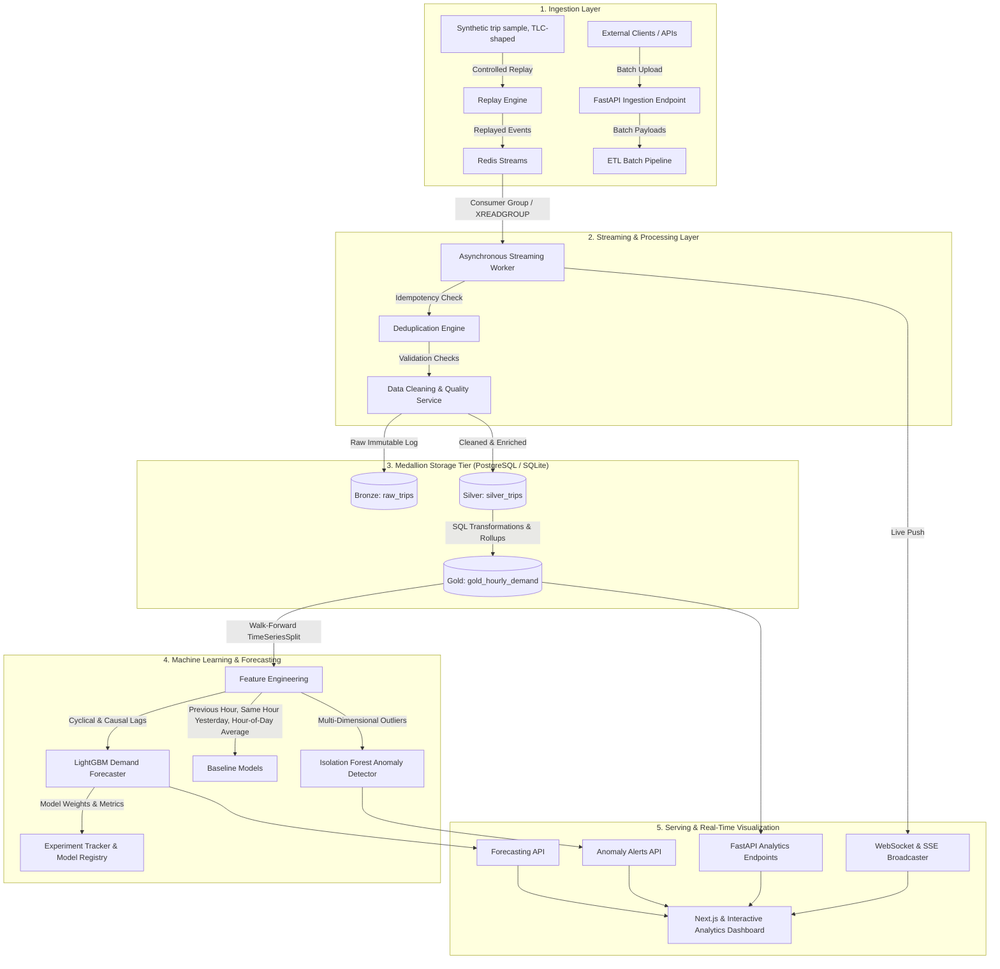

# Hailcast Architecture & System Design

Hailcast is a data engineering and predictive analytics platform engineered to demonstrate the end-to-end lifecycle of a modern streaming and analytical data system.

## Medallion Architecture Breakdown

### 1. Bronze Tier (`raw_trips`)
- **Nature**: Append-only, immutable event log.
- **Fields**: Deterministic `event_id`, timestamps, locations, raw fares, and `is_replayed` boolean flag.
- **Purpose**: High-throughput ingestion preserving source fidelity for auditability and historical replay.

### 2. Silver Tier (`silver_trips`)
- **Nature**: Cleaned, deduplicated, enriched operational records.
- **Transformations**:
  - Filter invalid temporal sequences (`dropoff <= pickup`).
  - Outlier filtering (duration outside 1–240 minutes, speed exceeding 85 mph, non-positive fares).
  - Feature derivation: `trip_duration_minutes`, `speed_mph`.
- **Purpose**: Reliable, sanitized ground truth for downstream modeling and business analytics.

### 3. Gold Tier (`gold_hourly_demand`)
- **Nature**: Pre-aggregated hourly analytical tables.
- **Aggregations**: `trip_count`, `total_passengers`, `avg_fare`, `avg_distance`, `total_revenue`, `avg_duration_minutes`.
- **Enrichments**: `anomaly_score`, `is_anomaly` flags populated by the Isolation Forest detector.
- **Purpose**: Sub-millisecond dashboard queries and high-velocity model feature stores.

---

## Controlled Replay Engine & Data Integrity

- **Simulated Real-Time Streaming**: Historical trip events are read in chronological order and replayed through Redis Streams at customizable speed factors ($1\times, 5\times, 10\times, 50\times$).
- **Strict Labeling**: Every replayed record is marked with `is_replayed = True` to fulfill strict regulatory and data requirement transparency.
- **Idempotent Deduplication**: Each event generates a deterministic hash `event_id = SHA256(pickup_datetime, dropoff_datetime, pickup_location, dropoff_location, fare)`. Any re-delivered or re-played duplicate event is rejected before entering the Silver tier.

